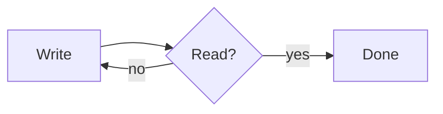

# A reading test

The quick brown fox jumps over the lazy dog, then reflects on **typography**, *rhythm*, and the `measure` of a line. Good body text sits near sixty-six characters per line, with generous leading, so the eye can return to the next line without effort.

## Lists and quotes

- First point with a [link](https://example.com)
- Second point
  - nested thing

1. One
2. Two

> A quotation is set apart, quieter than the body, so it reads as someone else's voice.

### Code

```js
export function add(a, b) {
  return a + b; // simple
}
```

| Type | Font |
|---|---|
| Body | Quattro |
| Code | Mono |

---



#### Small heading

The end.
